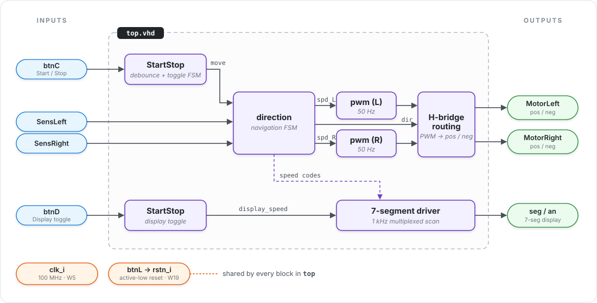
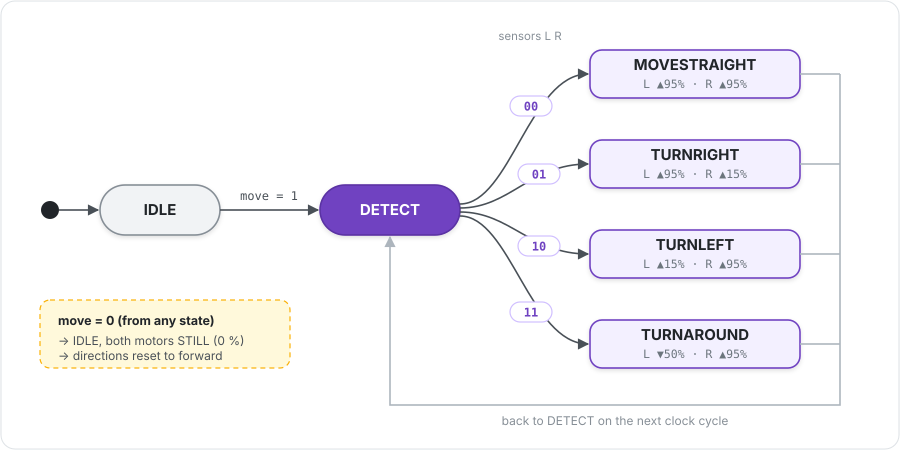

<div align="center">

# 🛸 Autonomous Drone — Line Follower on FPGA

**A line-following rover controller written in pure VHDL, synthesized for the Digilent Basys 3 (Xilinx Artix-7).**

Two infrared sensors watch the track, a finite state machine decides, and two 50 Hz PWM generators drive the motors.


</div>

---

## 📖 Table of contents

- [Overview](#-overview)
- [Architecture](#-architecture)
- [Modules](#-modules)
- [Navigation logic](#-navigation-logic)
- [PWM generation](#-pwm-generation)
- [User interface](#-user-interface)
- [Pinout](#-pinout-basys-3)
- [Repository layout](#-repository-layout)
- [Simulation](#-simulation)
- [Build and flash](#-build-and-flash)
- [License](#-license)

---

## 🎯 Overview

This project was built for the *Architecture, Design and Synthesis of Hardware Systems* course (BE). The goal was to design, validate, and integrate a small autonomous vehicle that **follows a black line** on the ground.

| | |
|---|---|
| 🧠 **Brain** | Digilent Basys 3: Artix-7 `xc7a35tcpg236-1` with a 100 MHz clock |
| 👀 **Eyes** | 2 infrared sensors (left / right) that detect dark patterns |
| 🦾 **Muscles** | 2 DC motors, each driven by a 50 Hz PWM signal and controlled in both directions |
| 🔋 **Power** | Independent battery |
| 📟 **Feedback** | 4-digit 7-segment display that shows each motor's duty cycle in % |

Everything is plain synchronous RTL: no soft-core CPU, no IP cores. Every asynchronous input passes through a **two-flip-flop synchronizer**, and the push buttons are **debounced** (10 ms).

---

## 🏗 Architecture

<p align="center">
  
</p>

> `btnL` is inverted into the global active-low reset `rstn_i`, which is shared by every module.

---

## 🧩 Modules

| File | Entity | Role |
|---|---|---|
| [`rtl/drone_pkg.vhd`](rtl/drone_pkg.vhd) | `drone_pkg` | Shared constants: speed codes, duty cycles, divider ratios, 7-seg patterns, plus a `slv_to_hstring` helper for testbenches |
| [`rtl/top.vhd`](rtl/top.vhd) | `top` | Top level: wires everything together, routes the PWM to the motor `pos`/`neg` pins, drives the 7-segment display |
| [`rtl/StartStop.vhd`](rtl/StartStop.vhd) | `StartStop` | 2-FF synchronizer, then a debouncer, then a one-shot pulse feeding a 2-state toggle FSM (`STOP ⇄ START`). Used **twice**: once for run/stop, once for the display |
| [`rtl/direction.vhd`](rtl/direction.vhd) | `direction` | Synchronizes the sensors and runs the navigation FSM, which outputs a speed level and a rotation direction for each wheel |
| [`rtl/pwm.vhd`](rtl/pwm.vhd) | `pwm` | Divides 100 MHz down to a 5 kHz tick, counts 0–99, and compares the count with the duty cycle to produce a 50 Hz PWM with 1 % resolution |

---

## 🧭 Navigation logic

The `direction` FSM loops through **`DETECT → action → DETECT`** as long as the drone is running. A sensor reads `1` when it sees the black line.

<p align="center">
  
</p>

The sensor vector is `SensLeft & SensRight`:

| Sensors `L R` | Action | Left wheel | Right wheel | Effect |
|:---:|---|:---:|:---:|---|
| `0 0` | **MOVESTRAIGHT** | ⬆️ 95 % | ⬆️ 95 % | Full speed ahead |
| `0 1` | **TURNRIGHT** | ⬆️ 95 % | ⬆️ 15 % | Right wheel slows down → veer right |
| `1 0` | **TURNLEFT** | ⬆️ 15 % | ⬆️ 95 % | Left wheel slows down → veer left |
| `1 1` | **TURNAROUND** | ⬇️ 50 % | ⬆️ 95 % | Left wheel reverses → spin left |
| — | **IDLE** (`move = 0`) | ⏹ 0 % | ⏹ 0 % | Stopped |

> 💡 The speed registers only reset while the drone is stopped. During the one-cycle `DETECT` state they keep their previous value, so the motors never glitch.

---

## 〰️ PWM generation

```
100 MHz ──÷20 000──▶ 5 kHz tick ──▶ counter 0…99 ──▶ (cnt < duty) ──▶ pwm_o
                     (200 µs)       (100 steps = 20 ms → 50 Hz)
```

| Speed code | Constant | Duty cycle | High time / period |
|:---:|---|:---:|:---:|
| `100` | `SPEED_HIGH` | **95 %** | 19.0 ms / 20 ms |
| `010` | `SPEED_MID` | **50 %** | 10.0 ms / 20 ms |
| `001` | `SPEED_LOW` | **15 %** | 3.0 ms / 20 ms |
| `000` | `SPEED_STILL` | **0 %** | — |

The PWM goes to the motor's `pos` pin when the direction is forward (`0`) and to its `neg` pin when the direction is backward (`1`). The unused pin is held low, so the two H-bridge inputs are never driven high together.

---

## 🎮 User interface

| Button | Pin | Action |
|:---:|:---:|---|
| **btnC** | `U18` | ▶️ / ⏸ Toggle **Start / Stop** (debounced, one press = one toggle) |
| **btnD** | `U17` | 📟 Toggle the **7-segment display** on / off |
| **btnL** | `W19` | 🔄 **Reset** (active while held) |

When the display is on, it shows the current duty cycle of each motor, refreshed by a 1 kHz multiplexed scan:

```
 ┌────┬────┬────┬────┐
 │ L  │ L  │ R  │ R  │     e.g.  95 15  → turning right
 │tens│unit│tens│unit│           15 95  → turning left
 └────┴────┴────┴────┘           95 95  → straight
  an3  an2  an1  an0             00 00  → stopped
```

---

## 📌 Pinout (Basys 3)

| Port | Direction | Pin | Basys 3 resource |
|---|:---:|:---:|---|
| `clk_i` | in | `W5` | 100 MHz oscillator |
| `Start_Stop_btn` | in | `U18` | btnC |
| `btn_L` | in | `W19` | btnL (reset) |
| `display_en` | in | `U17` | btnD |
| `SensRight` | in | `P18` | Right IR sensor |
| `SensLeft` | in | `B16` | Left IR sensor |
| `MotorLeft_pos` | out | `A15` | Pmod JB7 |
| `MotorLeft_neg` | out | `A17` | Pmod JB8 |
| `MotorRight_pos` | out | `P17` | Pmod JC9 |
| `MotorRight_neg` | out | `R18` | Pmod JC10 |
| `seg[6:0]` | out | `U7 V5 U5 V8 U8 W6 W7` | 7-seg cathodes (active low, `gfedcba`) |
| `an[3:0]` | out | `W4 V4 U4 U2` | 7-seg anodes (active low) |

All I/O use `LVCMOS33`. The full constraint file is `Drone_Vivado_project/project_1/project_1.srcs/constrs_1/new/drone_constraint.xdc`.

---

## 🗂 Repository layout

```
.
├── rtl/                       # Synthesizable VHDL sources
│   ├── drone_pkg.vhd          #   shared constants & helpers
│   ├── top.vhd                #   top level + 7-seg driver
│   ├── StartStop.vhd          #   debouncer + toggle FSM
│   ├── direction.vhd          #   navigation FSM
│   └── pwm.vhd                #   50 Hz PWM generator
├── sim/                       # Self-checking testbenches (ModelSim / Questa)
│   ├── pwm_tb/
│   ├── direction_tb/
│   ├── start_stop_tb/
│   └── top_tb/
├── docs/img/                  # README diagrams (SVG)
├── Drone_Vivado_project/      # Vivado project + XDC constraints
├── LICENSE
└── README.md
```

---

## 🧪 Simulation

Each testbench is **self-checking**: it counts errors and prints `TEST n PASSED` or `TEST n FINISHED WITH k ERROR(S)`.

| Testbench | What it checks |
|---|---|
| `pwm_tb` | Duty cycle over a full period for HIGH / MID / LOW / STILL, plus the async reset |
| `direction_tb` | Straight, right, left, and turn-around commands, then `move = 0` (idle) and reset |
| `startstop_tb` | Toggling `STOP ⇄ START` from an asynchronous button input |
| `top_tb` | End-to-end: motor outputs for every navigation case and the 7-segment display |

### Run with ModelSim / Questa

```bash
cd sim/pwm_tb
vlib work
vcom -2008 ../../rtl/drone_pkg.vhd ../../rtl/pwm.vhd pwm_tb.vhd
vsim -c pwm_tb -do "add wave -r /*; run -all; quit"
```

For `top_tb`, compile every file in `rtl/` (`drone_pkg.vhd` first). The `DEBOUNCE_CYCLES` generic on `top` lets the testbench use a much shorter debounce time, so simulations stay fast.

### Run with GHDL (open-source alternative)

```bash
ghdl -a --std=08 rtl/drone_pkg.vhd rtl/pwm.vhd sim/pwm_tb/pwm_tb.vhd
ghdl -r --std=08 pwm_tb --wave=pwm.ghw
```

---

## 🔧 Build and flash

1. Open `Drone_Vivado_project/project_1/project_1.xpr` in **Vivado 2025.2** (target part `xc7a35tcpg236-1`).
2. Make sure the sources in `rtl/` and `drone_constraint.xdc` are included, with `top` as the top module.
3. Run **Synthesis → Implementation → Generate Bitstream**.
4. Open the **Hardware Manager**, connect the Basys 3 over USB, and program the device.
5. Put the drone on the track and press **btnC**. 🏁

---

## 📄 License

Released under the [MIT License](LICENSE). © 2026 Olivier Oribes.

<div align="center">
<sub>Made with ☕ and flip-flops.</sub>
</div>
